<div align="center">

# S-Way (Smart-Way)


### Intelligent Document Authenticity and Authorship Analysis System

**Beyond Similarity. Into Document Intelligence.**

Runs entirely in your browser — no server, no uploads, no tracking

</div>

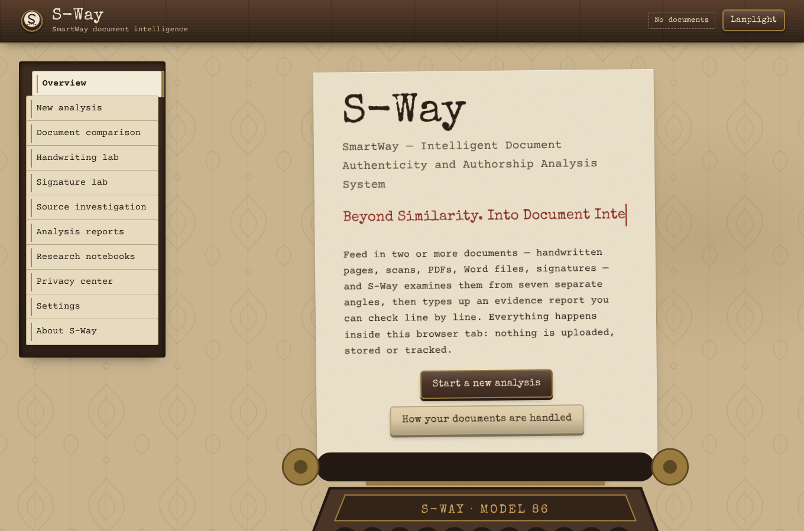

> **Important.** S-Way does not establish identity, misconduct, forgery, or plagiarism as a final determination. Findings require appropriate human examination.

---

## Overview

Teachers, integrity officers and researchers regularly face questions such as *"did these two students share work?"*, *"was this page written by the same hand?"*, *"where did this paragraph come from?"* or *"has this scanned page been edited?"*. The usual answer is a single opaque similarity percentage — often produced by uploading private documents to a third-party service.

S-Way takes a different approach:

- **Separate, explainable evidence.** The question is split into seven independent lines of evidence (text, writing style, handwriting, signatures, sources, layout, internal consistency). Each is reported on its own with the measurements behind it. Nothing is averaged into one score, and no result is presented as a probability of authorship.
- **Honest about weak evidence.** Short texts, low OCR confidence, poor images, conflicting modules and innocent explanations are spelled out in every report.
- **Private by construction.** Everything — file validation, PDF reading, OCR, computer vision, statistics, reporting — runs inside the browser tab. There is no backend to receive documents. Closing the tab discards everything.
- **Research-backed.** Seven executed Jupyter notebooks evaluate the exact JavaScript code the app ships, set its thresholds, and are readable inside the app.

The interface is styled as **a 1980s typewriter left in an abandoned house**: cream and beige paper sheets, walnut panelling, faded damask wallpaper, brass pins, and rubber-stamped verdicts. A *Lamplight* (dark) theme shows the same room after dark.

## Highlights

| | |
|---|---|
| 🔒 **Zero data leaves the device** | Strict Content-Security-Policy; no third-party origins; a test fails if any request leaves the site |
| 🛡️ **Hardened upload validation** | Magic-byte checks, ZIP-bomb / traversal / macro rejection, decompression-bomb image detection from headers |
| 🔍 **Seven evidence modules** | Text, stylometry (57 features), handwriting, signatures, sources, layout, anomaly & tamper screening |
| 📷 **Phone-photo correction** | Finds a photographed sheet's corners and flattens it before OCR (OCR error 44 % → 0.1 %) |
| ✂️ **Copy-move detection** | Finds regions pasted elsewhere on the same page, with 0 false alarms on held-out clean pages |
| ✍️ **Writer texture features** | Edge-hinge and spacing-rhythm histograms halve the synthetic writer error rate (7.4 % → 3.6 %) |
| 📓 **Notebooks in the app** | Read the executed research notebooks inside S-Way — no Jupyter needed |
| 🧪 **113 automated tests** | 84 unit + 29 browser tests, all passing; ruff, bandit, pip-audit, npm audit clean |
| 📱 **Responsive & accessible** | Works on phones; keyboard navigation; labels never rely on colour alone |

## Screenshots

| | |
|---|---|
| 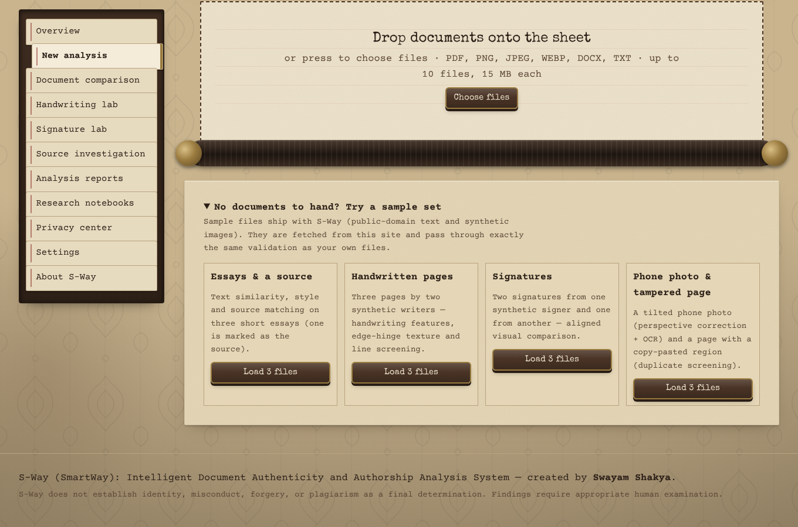 **New analysis** — drop files on the sheet or load a sample set | 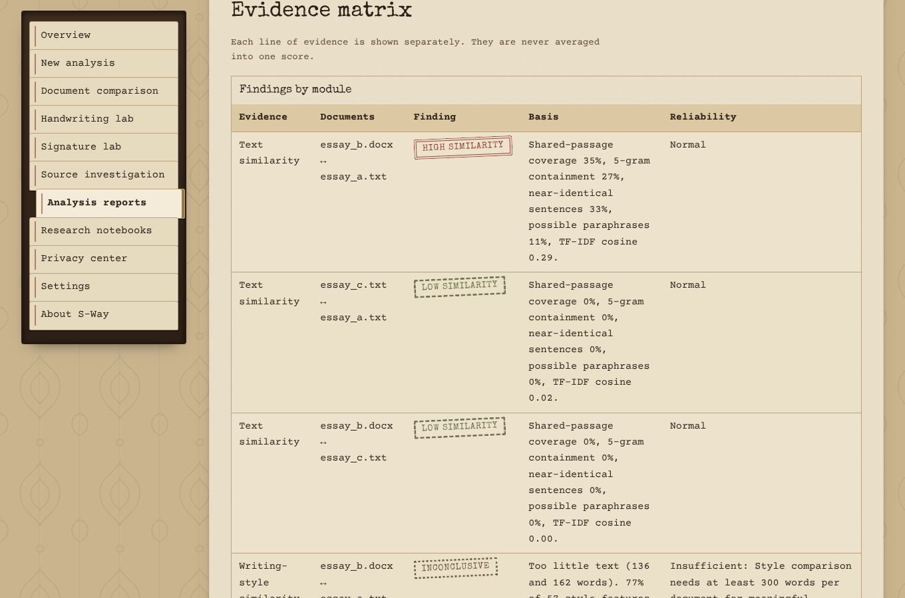 **Evidence matrix** — every line of evidence stamped separately |
| 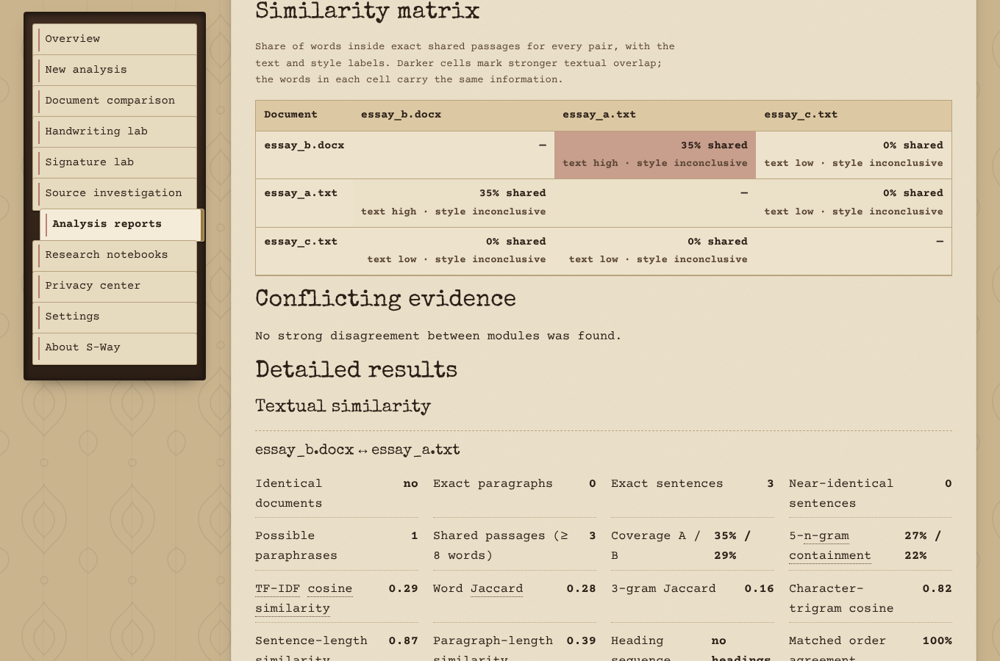 **Similarity matrix** — every pair at a glance | 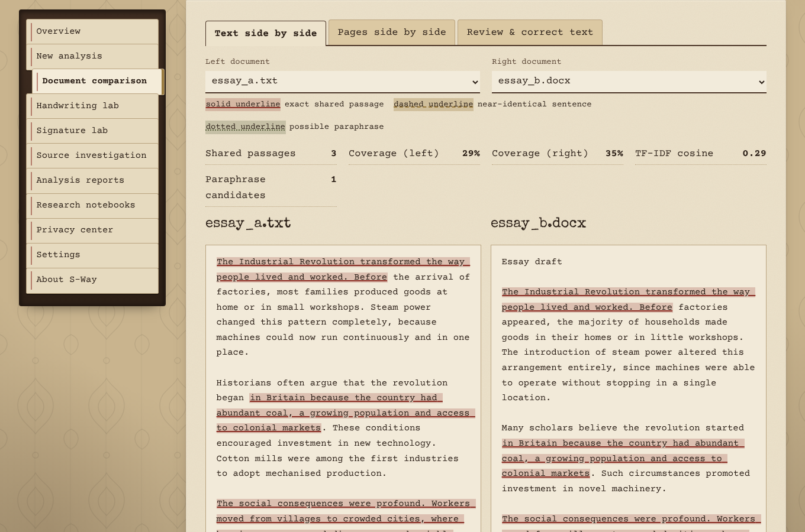 **Document comparison** — exact (solid), near-identical (dashed) and paraphrase (dotted) marks |
| 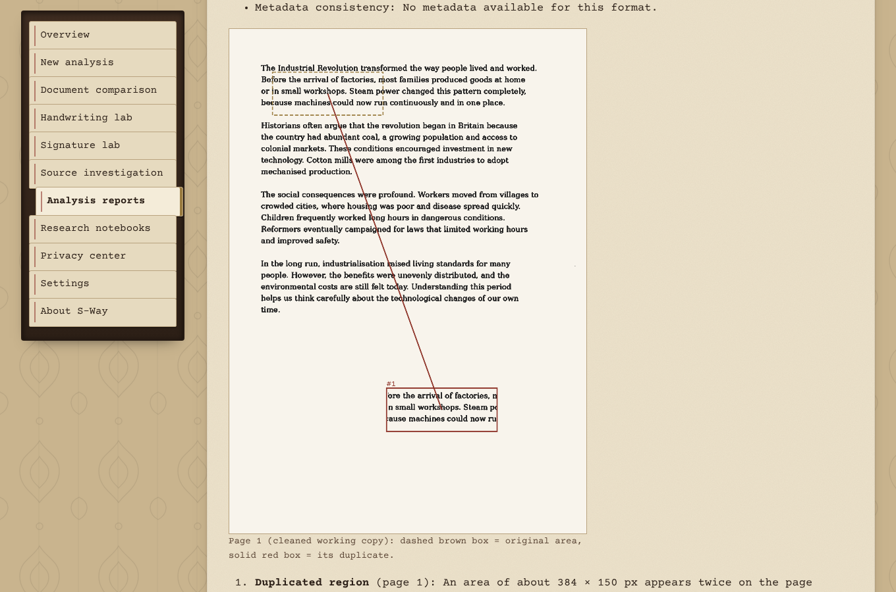 **Tamper screening** — a region copied and pasted on the same page | 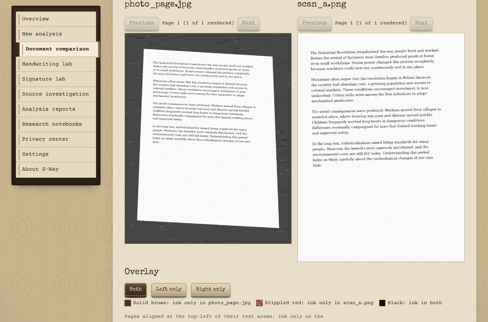 **Pages side by side** — the phone photo next to the scan |
| 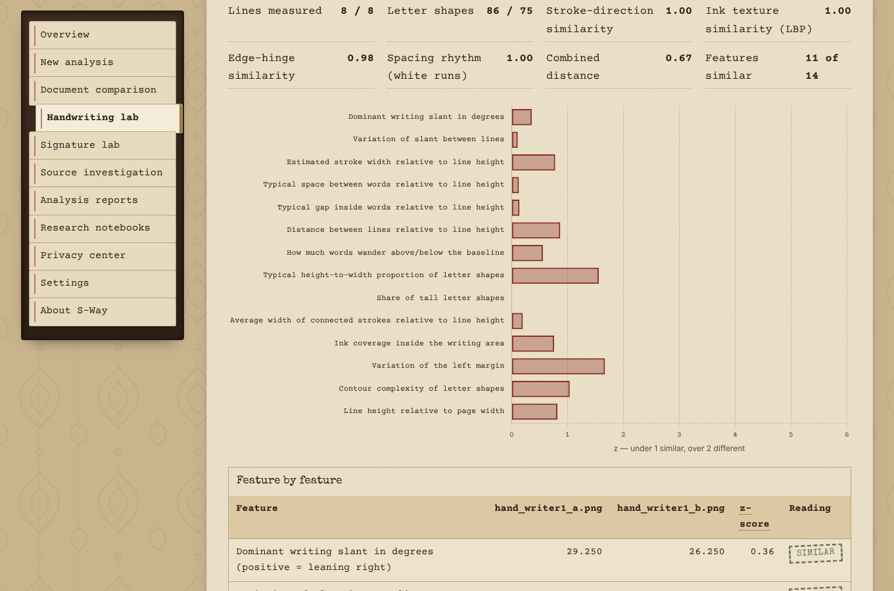 **Handwriting lab** — 14 features + edge-hinge texture | 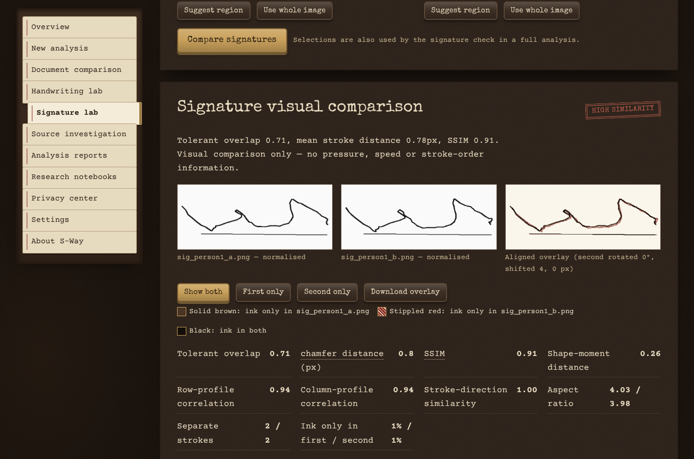 **Signature lab** in the Lamplight theme |
| 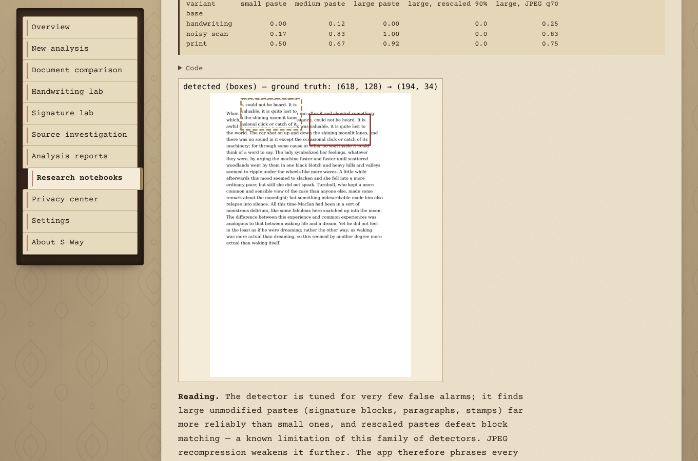 **Research notebooks** read inside the app | 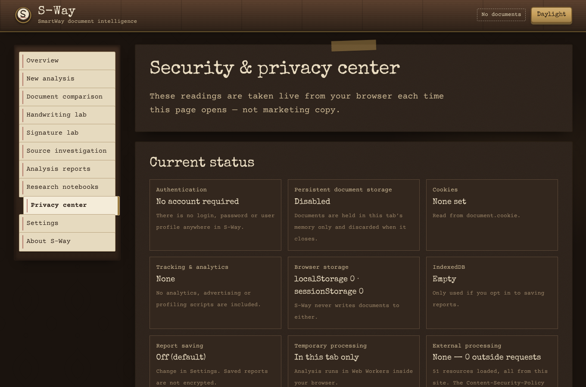 **Privacy center** — live storage and network checks |

<p align="center">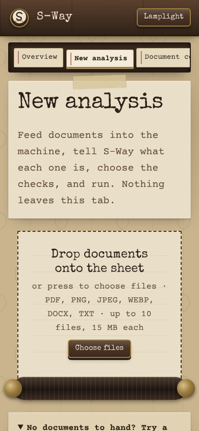</p>

## Quick start

**Requirements:** a modern browser (Chrome, Edge, Firefox, Safari) and, for the local server, Node.js 20 or newer. No `npm install` is needed — every library is bundled in `vendor/`.

```bash
git clone https://github.com/<your-username>/S-Way.git
cd S-Way
npm start            # → open http://127.0.0.1:8000
```

`npm start` runs `tools/serve.mjs`, a small dependency-free server that also sends the production security headers. Any static server works (`python3 -m http.server 8000`).

> Opening `index.html` directly from disk (`file://`) does **not** work: browsers block module workers there. Use a local server or GitHub Pages.

**No documents to hand?** On *New analysis*, open **"Try a sample set"** and load essays, handwritten pages, signatures, or a phone photo with a tampered page.

## Using S-Way, step by step

1. **New analysis.** Drop up to 10 files (PDF, PNG, JPEG, WEBP, DOCX, TXT; 15 MB each, 40 MB total, 50 PDF pages) onto the sheet. Each file is checked by its *contents*; disguised or dangerous files are stamped **Rejected** with the reason.
2. **Describe each document (optional).** *Role*: reference, under examination, known/unknown writing sample, source material, assignment submission. *Content*: digital text, printed/scanned page, handwritten page, signature, or automatic. S-Way never assumes the first file is the authentic one.
3. **Choose checks** or tick *Complete analysis*. Checks that cannot apply (e.g. handwriting on a typed PDF) are disabled with the reason.
4. **Run.** Progress is typed out line by line; you can cancel at any time. Every job has hard time limits.
5. **Read the report**: executive summary, notes on the documents, module status, main findings, limitations, areas for review, evidence matrix, similarity matrix, conflicting evidence, detailed results, numbered evidence details (F-001 …) and alternative explanations.
6. **Inspect**: *Document comparison* (highlighted text side by side, page images, overlays, text correction), *Handwriting lab*, *Signature lab* (drag to select a signature), *Source investigation*.
7. **Export**: PDF (browser print → *Save as PDF*), JSON, CSV (formula-injection safe), overlay PNGs.
8. **Clear**: *Privacy center → Clear current session* wipes all documents, images, reports and workers.

**Correcting OCR.** Handwriting and poor scans produce imperfect text. *Document comparison → Review & correct text* lets you fix it; the original extraction is kept and can be restored, and reports say when corrected text was used.

## The seven lines of evidence

| Module | What it measures | Methods |
|---|---|---|
| **Text similarity** | Copied, near-identical and reworded passages | Exact passages (≥ 8 words) with character offsets, word n-grams, 5-gram containment, TF-IDF cosine, character-trigram sentence alignment, sentence/paragraph length distributions, heading sequence, matched-order agreement |
| **Writing style** | How alike the writing *habits* are | 57 features (sentence rhythm, vocabulary diversity, punctuation, capitalisation, 30 function words, sentence openings …) compared by chunk-based Welch z-scores against each text's own variation; standardised cosine/distance; average-linkage clustering for 3+ documents |
| **Handwriting features** | Measurable characteristics of a hand | Line and word segmentation; slant (shear search), stroke width, word/letter gaps, line spacing, baseline wobble, letter proportions, ascenders, connectedness, ink density, margin regularity, contour complexity, writing size; stroke-direction (Sobel), LBP texture, **edge-hinge** and **white-run** histograms |
| **Signature comparison** | Visual likeness of two signatures | Otsu binarisation, tight crop, aspect-preserving normalisation, rotation/shift alignment search, tolerant overlap, chamfer distance, SSIM, Hu moments, profile correlations, difference map and region list |
| **Source investigation** | Which passages come from supplied sources | Text engine per examined/source pair; page and paragraph references; combined coverage |
| **Layout & formatting** | Page geometry and typography | Margins, line spacing/height, density, utilisation, edge alignment, indentation; PDF/DOCX font and size distributions, page numbering, page size; aligned page overlays |
| **Anomaly screening** | Parts of a document unlike the rest | Robust z-scores (median/MAD) + Isolation Forest over text segments, handwriting lines and pages; **copy-move duplicated regions**; PDF/DOCX metadata date checks |

## Research notebooks (Jupyter)

Open **Research notebooks** in the app to read them, or run them yourself. They call the shipped JavaScript engines through `tools/sway-cli.mjs`, so every number describes the real implementation.

| Notebook | Contents |
|---|---|
| `00_dataset_exploration` | Corpus statistics and biases, function-word heat map, gallery of synthetic writers, signatures, phone photos, copy-move edits, fixture inventory |
| `01_text_similarity_benchmark` | 250-pair benchmark (verbatim and rule-paraphrased insertions of 10–80 %); threshold search; confusion matrix; error analysis |
| `02_stylometry_evaluation` | Same- vs different-author AUC at 300/1,000/2,500 words; label thresholds; supervised attribution with GroupKFold by book; clustering |
| `03_handwriting_signature_synthetic` | Writer-disjoint evaluation (36 writers); feature scales; edge-hinge ablation and learned weights; robustness to blur/noise/rotation/low-res/JPEG; genuine vs random vs skilled signature forgeries |
| `04_ocr_evaluation` | Character/word error rates under degradations; OCR confidence on handwriting |
| `06_preprocessing_and_tampering` | Phone-photo corner error and OCR before/after rectification; copy-move detection by paste size, hard cases, false alarms (held-out set) |
| `05_export_calibration` | Writes `models/calibration.json` and its SHA-256 in `models/model_manifest.json` |

```bash
pip install -r requirements.txt        # plus the Tesseract 5 binary for notebooks 04 and 06
python3 tools/build_notebooks.py       # build + execute everything (~6 minutes)
python3 tools/build_notebooks.py 03_ 05_   # selected notebooks only
jupyter notebook notebooks/            # interactive exploration
```

**Data.** Project Gutenberg texts (public domain, via the NLTK data repository) in `notebooks/data/gutenberg/`. All images are synthetic and generated by code — no personal data. Real handwriting/signature datasets (IAM, CVL, CEDAR, GPDS) require licence agreements and were not used.

## Measured results

From the executed notebooks (details in [docs/MODEL_CARD.md](docs/MODEL_CARD.md)):

| Task | Result |
|---|---|
| Text — *Moderate* label vs ≥ 10 % inserted material | precision 1.00, recall 0.99, 0 false positives |
| Text — *High* label vs ≥ 30 % verbatim | recall 1.00, false-positive rate 1.6 % |
| Style — same vs different author (AUC) | 0.60 (300 words) → 0.77 (1,000) → 0.94 (2,500) |
| Handwriting, synthetic unseen writers — v1.0 → v1.1 | AUC 0.984 → **0.995**, EER 7.4 % → **3.6 %** |
| Signatures, synthetic — genuine vs random / skilled forgery (AUC) | 1.00 / 0.947 — every skilled forgery still looked "highly similar" |
| OCR on clean / noisy print (character error) | 0.2 % / 1.3 % |
| Phone photos — sheet found, corner error | 16 / 16, 7.8 px |
| Phone photos — OCR error raw → rectified | **44 % → 0.1 %** |
| Copy-move — false alarms on clean pages | **0 / 26** |
| Copy-move — large / medium / small pastes localised | 65 % / 54 % / 27 % (printed pages: 92 % of large pastes) |

Handwriting and signature numbers come from synthetic data and **do not** estimate real-world accuracy.

## Security and privacy

| Area | Controls |
|---|---|
| **Network** | Meta CSP: `default-src 'none'`, `script-src 'self'`, `connect-src 'self'`, `object-src 'none'`, `form-action 'none'`, no `unsafe-inline`/`unsafe-eval`. Only same-site fetches (calibration, notebooks, samples) — enforced by tests |
| **Uploads** | Filename inspection (traversal, null bytes, bidi tricks), extension allowlist, magic bytes, MIME agreement, size/batch limits, image header dimensions, PDF structure/encryption/active-content detection, defensive ZIP reader (entry count, sizes, ratio, traversal, symlinks, overlaps, CRC, lying sizes), macro rejection, no XML DTD/entities, strict TXT decoding |
| **Processing** | Web Workers with per-step and per-job timeouts, real cancellation (worker termination), bounded queue, duplicate-job refusal, rate limits (with the specified "Too many analysis requests" message), page/pixel/character budgets; PDF.js with scripting and font loading disabled |
| **Browser** | No `innerHTML`/`eval` anywhere (enforced by tests), text inserted with `textContent`, frame guard, object-URL revocation, CSV formula-injection protection |
| **Privacy** | No cookies, no web storage, no analytics, no logs; OCR data not cached; idle auto-clear after 30 minutes; *Clear current session*; optional, opt-in, clearly-labelled unencrypted report saving |
| **Supply chain** | Pinned vendored libraries (`npm audit`: 0), `pip-audit`, `bandit`, `ruff`, secret scan, CI on every push |

Full details: [SECURITY.md](docs/SECURITY.md) · [PRIVACY.md](docs/PRIVACY.md) · [SECURITY_AUDIT.md](docs/SECURITY_AUDIT.md)

## Limits and configuration

All limits live in `js/config.js`:

| Limit | Value |
|---|---|
| File size / files per analysis / combined | 15 MB / 10 / 40 MB |
| PDF pages | 50 (first 5 rendered for visual analysis) |
| Image dimensions | 10,000 × 10,000 px and 40 megapixels |
| Extracted text | 2,000,000 characters |
| DOCX expansion | 100 MB, 1,000 entries, ratio ≤ 100 : 1 |
| Job time limit | 120 s (OCR 60 s per page, 30 OCR pages per analysis) |
| Rate limits (per 10 min) | analyses 5, uploads 10, OCR 10, visual/ML 5, exports 10 |
| Idle auto-clear | 30 minutes |

## Known limitations

- OCR is English-only and trained on print; handwriting OCR is poor — use the text correction view.
- Paraphrase detection is lexical; heavy rewording is missed. No internet source search.
- Writing style needs long texts (≥ 1,000 words for useful separation) and is confounded by genre and topic.
- Handwriting and signature modules are feature-based and validated only on synthetic data; signatures are compared visually (no pressure, speed or stroke order).
- Copy-move screening misses rescaled/rotated pastes, splices from other images and very small edits; a clean result is not proof of authenticity.
- GitHub Pages cannot send security headers (mitigated by the meta CSP and frame guard).

Full list: [docs/LIMITATIONS.md](docs/LIMITATIONS.md).

## Credits and licences

S-Way is released under the **MIT licence** (© 2026 Swayam Shakya). Bundled third-party components keep their own licences:

| Component | Licence |
|---|---|
| PDF.js 6.5 (Mozilla) | Apache-2.0 |
| Tesseract.js 7, tesseract.js-core 7, English `best_int` data | Apache-2.0 |
| Chart.js 4.6 | MIT |
| Special Elite typeface (Astigma) | Apache-2.0 |
| Courier Prime typeface (Quote-Unquote Apps) | SIL Open Font License 1.1 |
| Project Gutenberg texts (research corpus) | Public domain |

Methods draw on published work, including Sauvola & Pietikäinen (adaptive binarisation), Fridrich, Soukal & Lukáš (copy-move detection), Bulacu & Schomaker (edge-hinge writer features), Burrows (function-word stylometry), Liu, Ting & Zhou (Isolation Forest) and Wang et al. (SSIM).

## Author

**Swayam Shakya** — concept, design, implementation, research and documentation of S-Way (SmartWay).

<div align="center">

*S-Way does not establish identity, misconduct, forgery, or plagiarism as a final determination.*
*Findings require appropriate human examination.*

</div>
